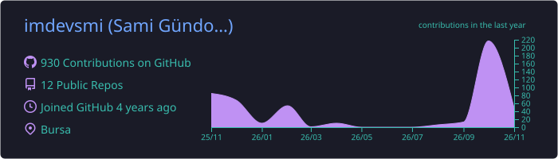
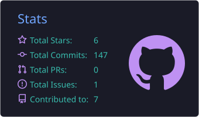
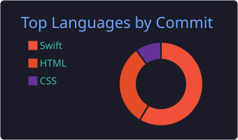

<!-- ===================== HEADER ===================== -->
<p align="center">
  
</p>

<div align="center">

  

  <p><em>Turning ideas into smooth mobile experiences.</em></p>

  <a href="https://www.linkedin.com/in/samigundogan/">
    
  </a>
  <a href="https://medium.com/@devsmi.me">
    
  </a>
  <a href="mailto:gundogannsami@gmail.com">
    
  </a>

  <br/><br/>

  

</div>

<br/>

<!-- ===================== ABOUT ===================== -->
## 👨‍💻 About Me

<table>
<tr>
<td width="55%" valign="top">

I'm a **Computer Science graduate** and a passionate **iOS Developer**. I love building clean, user‑friendly apps on top of solid, modern architecture.

- 🧠 &nbsp;**Focus:** Swift, UIKit, SwiftUI
- 🏛️ &nbsp;**Architecture:** MVVM, Clean Architecture
- 🔧 &nbsp;**Core:** Data Structures & Algorithms
- 🚀 &nbsp;**Goal:** Crafting high‑performance mobile apps
- ✍️ &nbsp;**Writing:** Sharing what I learn on [Medium](https://medium.com/@devsmi.me)
- 💬 &nbsp;**Ask me about:** iOS, Swift, app architecture

</td>
<td width="45%" valign="top">

```swift
struct Sami: Developer {
    let role       = "iOS Developer"
    let education  = "Computer Science"
    let language   = "Swift"
    let ui         = ["UIKit", "SwiftUI"]
    let patterns   = ["MVVM", "Clean Arch"]
    let loves      = "Smooth UX ✨"

    func build(_ idea: Idea) -> App {
        idea.polished().shipped()
    }
}
```

</td>
</tr>
</table>

<!-- ===================== TECH STACK ===================== -->
## 🛠️ Tech Stack

<div align="center">

**📱 iOS**


**☁️ Backend & Data**


**🧰 Tools**


</div>

<!-- ===================== STATS ===================== -->
## 📊 GitHub Stats

<div align="center">
  
  <br/>
  
  
  <br/><br/>
  <picture>
    <source media="(prefers-color-scheme: dark)" srcset="https://raw.githubusercontent.com/imdevsmi/imdevsmi/output/github-snake-dark.svg" />
    <source media="(prefers-color-scheme: light)" srcset="https://raw.githubusercontent.com/imdevsmi/imdevsmi/output/github-snake.svg" />
    
  </picture>
</div>

<!-- ===================== QUOTE ===================== -->
## ✍️ Random Dev Quote

<div align="center">
  
</div>

<br/>

<div align="center">
  <sub>⭐ Thanks for stopping by! Let's build something great together. ⭐</sub>
</div>

<!-- ===================== FOOTER ===================== -->
<p align="center">
  
</p>
