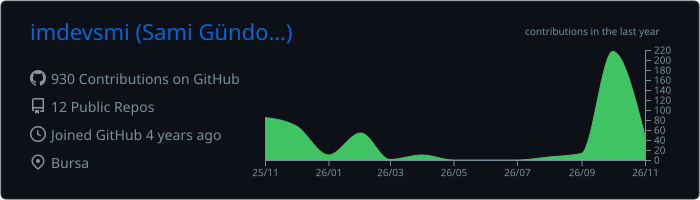

<!-- ===================== HEADER ===================== -->
<p align="center">
  
</p>

<div align="center">

  

  <p><em>Turning ideas into smooth mobile experiences.</em></p>

  <a href="https://www.linkedin.com/in/samigundogan/">
    
  </a>
  <a href="https://medium.com/@devsmi.me">
    
  </a>
  <a href="mailto:gundogannsami@gmail.com">
    
  </a>

  <br/><br/>

  

</div>

<br/>

<!-- ===================== ABOUT ===================== -->
## 👨‍💻 About Me

<table>
<tr>
<td width="55%" valign="top">

I'm a **Computer Science graduate** and a passionate **iOS Developer**. I love building clean, user‑friendly apps on top of solid, modern architecture.

- 🧠 &nbsp;**Focus:** Swift, UIKit, SwiftUI
- 🏛️ &nbsp;**Architecture:** MVVM, Clean Architecture
- 🔧 &nbsp;**Core:** Data Structures & Algorithms
- 🚀 &nbsp;**Goal:** Crafting high‑performance mobile apps
- ✍️ &nbsp;**Writing:** Sharing what I learn on [Medium](https://medium.com/@devsmi.me)
- 💬 &nbsp;**Ask me about:** iOS, Swift, app architecture

</td>
<td width="45%" valign="top">

```swift
struct Sami: Developer {
    let role       = "iOS Developer"
    let education  = "Computer Science"
    let language   = "Swift"
    let ui         = ["UIKit", "SwiftUI"]
    let patterns   = ["MVVM", "Clean Arch"]
    let ai         = ["Groq", "LLM APIs", "Claude Code"]
    let loves      = "Smooth UX ✨"

    func build(_ idea: Idea) -> App {
        idea.polished().shipped()
    }
}
```

</td>
</tr>
</table>

<!-- ===================== TECH STACK ===================== -->
## 🛠️ Tech Stack

<div align="center">

<h4>📱 iOS Development</h4>
<p>
  
  
  
  
  
  
  
  
  
</p>

<h4>🧪 Testing & Release</h4>
<p>
  
  
  
</p>

<h4>☁️ Backend & Data</h4>
<p>
  
  
  
</p>

<h4>💻 Also Code In</h4>
<p>
  
  
</p>

<h4>🧰 Tools</h4>
<p>
  
  
  
  
</p>

</div>

<!-- ===================== APPS ===================== -->
## 🚀 Live on the App Store

<table>
<tr>
<td width="50%" align="center" valign="top">
<h3>🔍 Scope: AI Analyst</h3>
<p><em>Smart Brief, Radar &amp; Finance</em></p>
<p align="left">AI-generated daily briefs across nine news categories, combined with live currency and gold rates, interactive finance charts, detailed weather and a Home Screen widget. No account required; personal data stays on the device.</p>
<p>  </p>
<a href="https://apps.apple.com/tr/app/scope-ai-analyst/id6754694355"></a>
</td>
<td width="50%" align="center" valign="top">
<h3>🔥 BrainFire AI</h3>
<p><em>AI Coach for Goals &amp; Focus</em></p>
<p align="left">A personal AI coach that turns big goals into daily progress, with focus sessions, a weekly planner with conflict checks and smart to-do reminders. Its social Crew feature lets friends focus together, and Premium is offered through in-app subscriptions.</p>
<p>  </p>
<a href="https://apps.apple.com/tr/app/brainfire-ai/id6757637163"></a>
</td>
</tr>
</table>

<!-- ===================== OPEN SOURCE ===================== -->
## 🧩 Open Source

<table>
<tr>
<td width="50%" valign="top">
<h3><a href="https://github.com/imdevsmi/AppThemeKit">🎨 AppThemeKit</a></h3>
<p>Drop-in light/dark/system appearance and accent color picker for UIKit apps, with a ready-made settings screen.</p>
 
</td>
<td width="50%" valign="top">
<h3><a href="https://github.com/imdevsmi/QiblaKit">🧭 QiblaKit</a></h3>
<p>Accurate WGS84 qibla direction and a smooth, themeable qibla compass for UIKit apps.</p>
 
</td>
</tr>
</table>

<!-- ===================== AI ===================== -->
## 🤖 AI-Powered Development

<table>
<tr>
<td width="50%" valign="top">
<h4>🧠 AI in my apps</h4>
<p>I integrate LLMs into production iOS apps for fast, real-time AI features.</p>


</td>
<td width="50%" valign="top">
<h4>⚡ AI in my workflow</h4>
<p>I use AI agents daily to design, build and ship faster without cutting corners on code quality.</p>

</td>
</tr>
</table>

<!-- ===================== STATS ===================== -->
## 📊 GitHub Stats

<div align="center">
  
  <br/><br/>
  <picture>
    <source media="(prefers-color-scheme: dark)" srcset="https://raw.githubusercontent.com/imdevsmi/imdevsmi/output/github-snake-dark.svg" />
    <source media="(prefers-color-scheme: light)" srcset="https://raw.githubusercontent.com/imdevsmi/imdevsmi/output/github-snake.svg" />
    
  </picture>
</div>

<!-- ===================== QUOTE ===================== -->
## ✍️ Random Dev Quote

<div align="center">
  
</div>

<br/>

<div align="center">
  <sub>⭐ Thanks for stopping by! Let's build something great together. ⭐</sub>
</div>

<!-- ===================== FOOTER ===================== -->
<p align="center">
  
</p>
